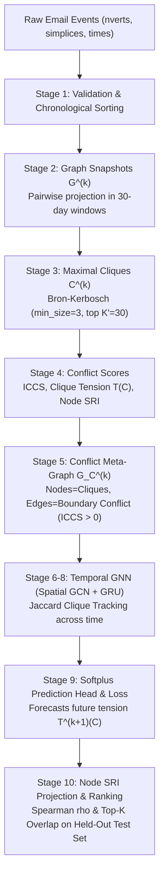

# Temporal Graph Neural Network for Organizational Silo Detection

[]()
[]()
[]()

---

## 1. Project Overview & Research Methodology

This repository provides an end-to-end, reproducible implementation and scientific audit of the **Temporal Graph Neural Network (GNN)** framework for predicting organizational silos and structural tension in evolving corporate communication networks.

### The Research Problem
Organizational silos emerge when subgroups within an enterprise communicate heavily internally while maintaining weak, fragile, or overloaded ties to external teams. Traditional static metrics fail to capture temporal drift—how communication degrades gradually over time.

This project implements the complete pipeline:
1. **Higher-Order Simplex Projection:** Converts multi-recipient emails into pairwise communication ties.
2. **Discrete Graph Snapshots:** Partitions communications into non-overlapping 30-day temporal windows ($T = 44$).
3. **Maximal Clique Extraction:** Uses the Bron–Kerbosch algorithm to identify cohesive groups (teams) of size $\ge 3$.
4. **Structural Conflict Scores:** Computes Inter-Clique Communication Sparsity (ICCS), Clique Tension $T(C)$, and Silo Risk Index (SRI).
5. **Clique-Conflict Meta-Graphs ($G_C$):** Constructs higher-order graphs where meta-nodes are cohesive cliques and edges encode boundary conflict ($\text{ICCS} > 0$).
6. **Temporal GNN Architecture:** Spatial Graph Convolutional Network (GCN) combined with a Gated Recurrent Unit (GRU) with Jaccard-based clique tracking across time.
7. **Empirical Benchmarking:** Multi-seed evaluation (5 seeds) under both **Protocol A** (Unconditional) and **Protocol B** (Conditional on survival) against Persistence, Historical Mean, Feature MLP, and Static GCN baselines on the Cornell Enron email corpus.

---

## 2. Complete Architecture & Data Flow



---

## 3. Mathematical Formulations

### A. Simplex to Pairwise Projection
For an email event with $k$ participants $\{v_1, \dots, v_k\}$, all $k(k-1)/2$ undirected edges $(v_i, v_j)$ with $i < j$ are added to snapshot $G^{(k)}$. Edge weights represent the count of shared emails within the snapshot window.

### B. Structural Conflict Metrics
- **External Neighbors:**
  $$N_{ext}(S) = \{v \in V \setminus S \mid \exists u \in S, (u, v) \in E\}$$
- **Boundary Overlap:**
  $$\text{overlap}(A, B) = \big(N_{ext}(A) \cap B\big) \cup \big(N_{ext}(B) \cap A\big)$$
- **Inter-Clique Communication Sparsity (ICCS):**
  $$\text{ICCS}(A, B) = \frac{|\text{overlap}(A, B)|}{|A| + |B|}$$
- **Instantaneous Clique Tension:**
  $$T(C) = \sum_{C' \neq C} \text{ICCS}(C, C')$$
- **Node-Level Silo Risk Index (SRI):**
  $$\text{SRI}(v) = \sum_{C \ni v} T(C)$$

### C. Spatial GCN Message Passing
For meta-graph with $K$ cliques and features $X \in \mathbb{R}^{K \times 5}$:
$$\hat{A} = \tilde{D}^{-1/2} \tilde{A} \tilde{D}^{-1/2}, \quad \text{where } \tilde{A} = A + I$$
$$H = \text{ReLU}\big(\hat{A} X W_0 + b_0\big)$$

### D. Recurrent GRU with Jaccard Clique Tracking
Cliques are aligned across snapshots using Jaccard node similarity:
$$J(C_i^{(k)}, C_j^{(k-1)}) = \frac{|C_i^{(k)} \cap C_j^{(k-1)}|}{|C_i^{(k)} \cup C_j^{(k-1)}|}$$
If $J \ge 0.5$, the hidden state is updated: $s_i^{(k)} = \text{GRUCell}(h_i^{(k)}, s_j^{(k-1)})$.  
If $J < 0.5$ (newly formed or restructured group), $s_i^{(k)} = h_i^{(k)}$.

Future tension prediction:
$$\hat{T}^{(k+1)}(C_i) = \text{Softplus}\big(\text{MLP}(s_i^{(k)})\big)$$

---

## 4. Results (current)

All numbers below come from `src/training/revision_experiments.py` and are saved in
`outputs/revision/revision_results.json`. Earlier tables in this README (and in
`outputs/audit/`) came from older runs and are superseded.

### Group turnover and the two protocols
Only 40.3% of retained cliques have a one-to-one Jaccard match (J ≥ 0.5) in the next
30-day snapshot. Dissolved cliques have no future tension, so we report:
- **Protocol A (deployable):** all cliques at k, dissolved ones scored as 0.
- **Protocol B (oracle-conditioned):** only cliques that survive to k+1. Not usable in
  practice, because survival is only known after the fact.

### Main findings
- **Protocol B, chronological test (35 survivors, 10 seeds):** persistence 5.04. GCN two-stage
  3.47 ± 1.17 and GCN trained on survivors without any classifier 3.52 ± 1.14. Every neural
  model's 95% block-bootstrap CI of the MSE difference from persistence includes zero.
- **Rolling origin (24 origins, 237 survivors):** persistence 11.56, ridge AR 11.08,
  recalibrated persistence 11.29. GCN two-stage 17.62 and GCN+GRU two-stage 18.89 are
  significantly worse than persistence (Wilcoxon p = 0.056 and 0.008).
- **Ablation (rolling, two-stage):** MLP 13.57, MLP+history features 14.86, GCN+history
  features 15.12, GCN 17.62, MLP+GRU 18.68, GCN+GRU 18.89. Neither the graph nor the GRU helps.
- **Survival classifiers:** neural survival heads are near chance (AUROC 0.42–0.60 on the
  test window). A logistic model on clique age and tension history reaches 0.67 under the
  rolling origin.
- **Protocol A (rolling):** persistence × logistic survival probability is the only forecast
  that clearly beats base-rate persistence (16.42 vs 19.42, p = 0.016).
- **Measurement:** 55% of retained cliques are exactly one email's participant list, and 10%
  of dissolutions come from the top-30 cut-off. Turnover stays high for Louvain communities
  (36% survival) and k-cores (46–52%).
- **Node-level SRI:** forecasts rank people about as well as this month's observed SRI
  (Spearman 0.528 vs 0.529). SRI correlates 0.82 with clique-membership count.

Note: "Static GCN" and "Temporal GNN (No GRU)" in the older scripts are the same
architecture. The current experiments treat them as one model, "GCN".

### Figures
`outputs/revision/figures/`: Protocol B controls with bootstrap CIs, rolling-origin
errors by origin, and sensitivity of survival to τ, K′ and window length.

---

## 6. Network Fragility Analysis Audit

### Relative Giant Component Size at 20% Node Removal:
- **In-Sample Disruption ($G^{(28)}$, 105 nodes):**
  - **Betweenness Centrality:** $\mathbf{38.8\%}$ (Most Destructive)
  - **Observed SRI:** $55.3\%$
  - **Degree Centrality:** $67.0\%$
  - **Predicted SRI (Temporal GNN):** $72.8\%$
  - **Random Removal (50 seeds):** $75.5\% \pm 2.3\%$
- **Forward Out-of-Sample Disruption ($G^{(29)}$, 107 nodes):**
  - **Betweenness Centrality:** $\mathbf{64.0\%}$
  - **Observed SRI (Persistence):** $68.4\%$
  - **Degree Centrality:** $73.7\%$
  - **Predicted SRI (Temporal GNN):** $75.4\%$
  - **Random Removal (50 seeds):** $75.4\% \pm 3.8\%$

- **Finding:** Betweenness Centrality collapses the network far more rapidly than SRI. When predicting future network collapse on $G^{(29)}$, Temporal GNN predicted SRI is **statistically indistinguishable from random removal** ($75.4\%$).

---

## 7. Execution & Reproduction Commands

### 0. Reproduce every number in the current paper (about 4 minutes)
```bash
python3 src/training/revision_experiments.py
python3 src/training/revision_figures.py
```
Outputs: `outputs/revision/revision_results.json` and `outputs/revision/figures/`.

### 1. Run Automated Test Suite (49 tests)
```bash
pytest -v
```

### 2. Run Multi-Seed Benchmark & Ablation Audit
```bash
python3 src/training/benchmark_audit.py
```
Outputs: `outputs/audit/benchmark_results.json` and `outputs/audit/benchmark_results.csv`.

### 3. Run Node SRI Ranking Audit
```bash
python3 src/training/audit_ranking.py
```
Outputs: `outputs/audit/ranking_evaluation.csv`.

### 4. Run Network Fragility Simulation Audit
```bash
python3 src/training/audit_fragility.py
```
Outputs: `outputs/audit/fragility_results.csv`.

### 5. Generate All 7 Audited Publication Figures
```bash
python3 src/training/generate_audit_figures.py
```
Outputs: `outputs/audit/figures/fig[1-7]_*.png` and `outputs/audit/figure_captions.md`.

---

## 8. Directory Structure

```
Temporal_GNN/
├── Dataset/email-Enron/          # Raw Cornell simplicial vectors
├── outputs/
│   ├── revision/                 # Current results: revision_results.json + figures
│   ├── audit/                    # Earlier audited reports, CSVs, JSONs, figures
│   │   ├── figures/              # Audited publication figures (Fig 1-7)
│   │   ├── benchmark_results.json
│   │   ├── benchmark_results.csv
│   │   ├── ranking_evaluation.csv
│   │   ├── fragility_results.csv
│   │   ├── implementation_audit.md
│   │   ├── methodology_audit.md
│   │   ├── results_analysis.md
│   │   └── figure_captions.md
│   └── backup_baseline_run/      # Immutable backup of original baseline run
├── src/
│   ├── data/                     # loader.py, snapshots.py, build_snapshots.py
│   ├── graph/                    # cliques.py, scores.py, meta_graph.py
│   ├── models/                   # gnn.py, baselines.py, temporal_gnn.py
│   └── training/                 # trainer.py, metrics.py, benchmark_audit.py, etc.
└── tests/                        # 49 unit, invariant, and regression tests
```
