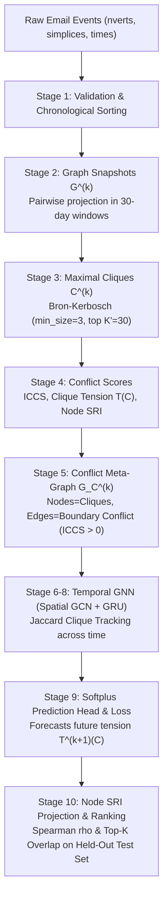

# Temporal Graph Neural Network for Organizational Silo Detection

[]()
[]()
[]()

---

## 1. Project Overview & Research Methodology

This repository provides an end-to-end, reproducible implementation and scientific audit of the **Temporal Graph Neural Network (GNN)** framework for predicting organizational silos and structural tension in evolving corporate communication networks.

### The Research Problem
Organizational silos emerge when subgroups within an enterprise communicate heavily internally while maintaining weak, fragile, or overloaded ties to external teams. Traditional static metrics fail to capture temporal drift—how communication degrades gradually over time.

This project implements the complete pipeline:
1. **Higher-Order Simplex Projection:** Converts multi-recipient emails into pairwise communication ties.
2. **Discrete Graph Snapshots:** Partitions communications into non-overlapping 30-day temporal windows ($T = 44$).
3. **Maximal Clique Extraction:** Uses the Bron–Kerbosch algorithm to identify cohesive groups (teams) of size $\ge 3$.
4. **Structural Conflict Scores:** Computes Inter-Clique Communication Sparsity (ICCS), Clique Tension $T(C)$, and Silo Risk Index (SRI).
5. **Clique-Conflict Meta-Graphs ($G_C$):** Constructs higher-order graphs where meta-nodes are cohesive cliques and edges encode boundary conflict ($\text{ICCS} > 0$).
6. **Temporal GNN Architecture:** Spatial Graph Convolutional Network (GCN) combined with a Gated Recurrent Unit (GRU) with Jaccard-based clique tracking across time.
7. **Empirical Benchmarking:** Multi-seed evaluation (5 seeds) under both **Protocol A** (Unconditional) and **Protocol B** (Conditional on survival) against Persistence, Historical Mean, Feature MLP, and Static GCN baselines on the Cornell Enron email corpus.

---

## 2. Complete Architecture & Data Flow



---

## 3. Mathematical Formulations

### A. Simplex to Pairwise Projection
For an email event with $k$ participants $\{v_1, \dots, v_k\}$, all $k(k-1)/2$ undirected edges $(v_i, v_j)$ with $i < j$ are added to snapshot $G^{(k)}$. Edge weights represent the count of shared emails within the snapshot window.

### B. Structural Conflict Metrics
- **External Neighbors:**
  $$N_{ext}(S) = \{v \in V \setminus S \mid \exists u \in S, (u, v) \in E\}$$
- **Boundary Overlap:**
  $$\text{overlap}(A, B) = \big(N_{ext}(A) \cap B\big) \cup \big(N_{ext}(B) \cap A\big)$$
- **Inter-Clique Communication Sparsity (ICCS):**
  $$\text{ICCS}(A, B) = \frac{|\text{overlap}(A, B)|}{|A| + |B|}$$
- **Instantaneous Clique Tension:**
  $$T(C) = \sum_{C' \neq C} \text{ICCS}(C, C')$$
- **Node-Level Silo Risk Index (SRI):**
  $$\text{SRI}(v) = \sum_{C \ni v} T(C)$$

### C. Spatial GCN Message Passing
For meta-graph with $K$ cliques and features $X \in \mathbb{R}^{K \times 5}$:
$$\hat{A} = \tilde{D}^{-1/2} \tilde{A} \tilde{D}^{-1/2}, \quad \text{where } \tilde{A} = A + I$$
$$H = \text{ReLU}\big(\hat{A} X W_0 + b_0\big)$$

### D. Recurrent GRU with Jaccard Clique Tracking
Cliques are aligned across snapshots using Jaccard node similarity:
$$J(C_i^{(k)}, C_j^{(k-1)}) = \frac{|C_i^{(k)} \cap C_j^{(k-1)}|}{|C_i^{(k)} \cup C_j^{(k-1)}|}$$
If $J \ge 0.5$, the hidden state is updated: $s_i^{(k)} = \text{GRUCell}(h_i^{(k)}, s_j^{(k-1)})$.  
If $J < 0.5$ (newly formed or restructured group), $s_i^{(k)} = h_i^{(k)}$.

Future tension prediction:
$$\hat{T}^{(k+1)}(C_i) = \text{Softplus}\big(\text{MLP}(s_i^{(k)})\big)$$

---

## 4. Multi-Seed Empirical Benchmarks & Scientific Audit

Evaluated chronologically across 44 discrete 30-day snapshots spanning Nov 1998 to June 2002:
- **Train Split (70%):** Snapshots 0 to 29 (Nov 1998 – May 2001)
- **Validation Split (15%):** Snapshots 30 to 35 (May 2001 – Oct 2001)
- **Held-Out Test Split (15%):** Snapshots 36 to 42 (Nov 2001 – May 2002; coincides with Enron Chapter 11 collapse)

### The Target Formulation Dilemma: Protocol A vs. Protocol B
In dynamic organizational networks, cliques frequently form and dissolve. In the held-out test split, 70 out of 109 cliques (**64.2%**) dissolved ($J < 0.5$).
- **Protocol A (Unconditional, $N=109$):** Evaluates all cliques. Dissolved cliques receive target tension zero ($y=0.0$).
- **Protocol B (Conditional on Survival, $N=39$):** Evaluates strictly persisting cliques that survive into $t+1$ with $J \ge 0.5$.

### 5-Seed Benchmark Results (Seeds: `[42, 123, 456, 789, 999]`)

| Model Architecture | Protocol A: Test MSE ($\mu \pm \sigma$) | Protocol A: Test MAE ($\mu \pm \sigma$) | Protocol A: Pearson $r$ | Protocol B: Test MSE ($\mu \pm \sigma$) | Protocol B: Test MAE ($\mu \pm \sigma$) | Protocol B: Pearson $r$ |
| :--- | :---: | :---: | :---: | :---: | :---: | :---: |
| **Persistence Baseline** | $24.53 \pm 0.00$ | $4.02 \pm 0.00$ | $0.2859$ | $\mathbf{5.09 \pm 0.00}$ | $\mathbf{1.94 \pm 0.00}$ | $\mathbf{0.7270}$ |
| **Historical Mean Baseline** | $6.01 \pm 0.00$ | $\mathbf{1.52 \pm 0.00}$ | $-0.0530$ | $18.56 \pm 0.00$ | $3.86 \pm 0.00$ | $0.0000$ |
| **Feature-Only MLP** | $5.34 \pm 0.20$ | $2.03 \pm 0.05$ | $0.2742$ | $7.74 \pm 0.32$ | $2.28 \pm 0.08$ | $0.3000$ |
| **Static GCN** | $\mathbf{4.96 \pm 0.09}$ | $1.75 \pm 0.14$ | $0.1479$ | $12.93 \pm 2.63$ | $3.13 \pm 0.37$ | $0.4729$ |
| **Temporal GNN (No GRU Ablation)** | $5.02 \pm 0.16$ | $1.86 \pm 0.18$ | $0.1963$ | $10.81 \pm 3.45$ | $2.80 \pm 0.48$ | $0.5292$ |
| **Temporal GNN (Full GCN + GRU)** | $7.13 \pm 1.20$ | $1.98 \pm 0.16$ | $0.0088$ | $14.10 \pm 3.95$ | $3.20 \pm 0.52$ | $0.1156$ |

### Key Scientific Takeaways:
1. **Does GRU memory improve performance?** **No.** Static GCN ($4.96 \pm 0.09$) and the No-GRU ablation ($5.02 \pm 0.16$) both outperform the Full Temporal GNN ($7.13 \pm 1.20$). The GRU adds parameter variance and suffers from state resets.
2. **Persistence is unbeatable on persisting cliques:** When cliques survive into the future, simply persisting past tension achieves $\text{MSE} = 5.09$ and Pearson $r = 0.7270$, outperforming all neural models. Neural models achieve lower MSE in Protocol A strictly by regularizing predictions toward zero when 64.2% of cliques dissolve.

---

## 5. Node-Level Silo Risk Index (SRI) Ranking Audit

| Ranking Strategy | Spearman $\rho$ (All 148 Nodes) | Top-5 Overlap | Top-10 Overlap | Spearman $\rho$ (Active Nodes Only) |
| :--- | :---: | :---: | :---: | :---: |
| **Betweenness Centrality** | $0.4022$ | $4.0\%$ | $10.0\%$ | $-0.0309$ |
| **Degree Centrality** | $0.4715$ | $12.0\%$ | $30.0\%$ | $0.4492$ ($p < 0.01$) |
| **Persistence Observed SRI** | $\mathbf{0.5187}$ | $\mathbf{36.0\%}$ | $\mathbf{48.0\%}$ | $\mathbf{0.4935}$ ($p < 10^{-4}$) |
| **Temporal GNN Predicted SRI** | $0.4687$ | $28.0\%$ | $30.0\%$ | $0.1183$ ($p > 0.05$ in 3/4 snaps) |

- **Finding:** Evaluating over all 148 employees yields $\rho \approx 0.51 - 0.54$ primarily because $\sim 120$ non-clique nodes share tied true scores of 0.0. When restricted to active employees at risk, **Persistence Observed SRI ($\rho = 0.4935$) and Degree Centrality ($\rho = 0.4492$) perform significantly better than Temporal GNN ($\rho = 0.1183$)**.

---

## 6. Network Fragility Analysis Audit

### Relative Giant Component Size at 20% Node Removal:
- **In-Sample Disruption ($G^{(28)}$, 105 nodes):**
  - **Betweenness Centrality:** $\mathbf{38.8\%}$ (Most Destructive)
  - **Observed SRI:** $55.3\%$
  - **Degree Centrality:** $67.0\%$
  - **Predicted SRI (Temporal GNN):** $72.8\%$
  - **Random Removal (50 seeds):** $75.5\% \pm 2.3\%$
- **Forward Out-of-Sample Disruption ($G^{(29)}$, 107 nodes):**
  - **Betweenness Centrality:** $\mathbf{64.0\%}$
  - **Observed SRI (Persistence):** $68.4\%$
  - **Degree Centrality:** $73.7\%$
  - **Predicted SRI (Temporal GNN):** $75.4\%$
  - **Random Removal (50 seeds):** $75.4\% \pm 3.8\%$

- **Finding:** Betweenness Centrality collapses the network far more rapidly than SRI. When predicting future network collapse on $G^{(29)}$, Temporal GNN predicted SRI is **statistically indistinguishable from random removal** ($75.4\%$).

---

## 7. Execution & Reproduction Commands

### 1. Run Automated Test Suite (49 tests)
```bash
pytest -v
```

### 2. Run Multi-Seed Benchmark & Ablation Audit
```bash
python3 src/training/benchmark_audit.py
```
Outputs: `outputs/audit/benchmark_results.json` and `outputs/audit/benchmark_results.csv`.

### 3. Run Node SRI Ranking Audit
```bash
python3 src/training/audit_ranking.py
```
Outputs: `outputs/audit/ranking_evaluation.csv`.

### 4. Run Network Fragility Simulation Audit
```bash
python3 src/training/audit_fragility.py
```
Outputs: `outputs/audit/fragility_results.csv`.

### 5. Generate All 7 Audited Publication Figures
```bash
python3 src/training/generate_audit_figures.py
```
Outputs: `outputs/audit/figures/fig[1-7]_*.png` and `outputs/audit/figure_captions.md`.

---

## 8. Directory Structure

```
Temporal_GNN/
├── Dataset/email-Enron/          # Raw Cornell simplicial vectors
├── outputs/
│   ├── audit/                    # Audited reports, CSVs, JSONs, figures
│   │   ├── figures/              # Audited publication figures (Fig 1-7)
│   │   ├── benchmark_results.json
│   │   ├── benchmark_results.csv
│   │   ├── ranking_evaluation.csv
│   │   ├── fragility_results.csv
│   │   ├── implementation_audit.md
│   │   ├── methodology_audit.md
│   │   ├── results_analysis.md
│   │   └── figure_captions.md
│   └── backup_baseline_run/      # Immutable backup of original baseline run
├── src/
│   ├── data/                     # loader.py, snapshots.py, build_snapshots.py
│   ├── graph/                    # cliques.py, scores.py, meta_graph.py
│   ├── models/                   # gnn.py, baselines.py, temporal_gnn.py
│   └── training/                 # trainer.py, metrics.py, benchmark_audit.py, etc.
└── tests/                        # 49 unit, invariant, and regression tests
```
