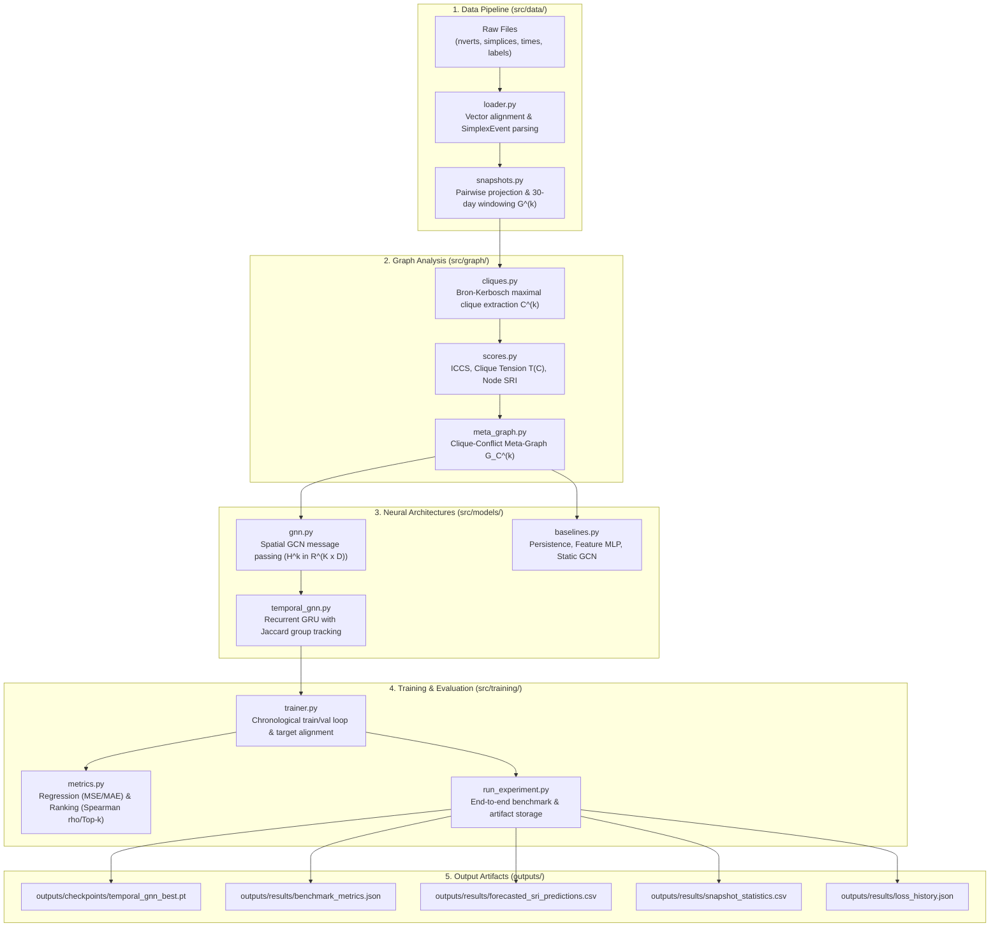

# Source Code Architecture & Methodology Guide (`src/`)

This document provides a comprehensive, file-by-file technical reference for the Temporal Graph Neural Network (GNN) implementation for organizational silo detection.

---

## 1. Complete System Architecture & Data Flow

---

## 2. File-by-File Breakdown & Technical Description

### Directory: `src/data/` (Data Loading & Graph Construction)

#### 1. `src/data/loader.py`
- **Purpose:** Loads, parses, and validates the raw higher-order communication dataset.
- **Key Classes & Functions:**
  - `SimplexEvent`: Immutable dataclass representing a timestamped email simplex. Contains `event_id`, `timestamp_raw`, and `participants` tuple. Converts raw ms from Gregorian Year 1 AD into UTC datetime.
  - `to_pairwise_edges()`: Expands a $k$-participant email into all $k(k-1)/2$ undirected pairs $(u, v)$ with $u < v$.
  - `load_raw_vectors()`: Reads `nverts.txt`, `simplices.txt`, `times.txt` with strict integer format verification.
  - `load_node_labels()`: Loads mapping of employee node IDs to corporate email addresses.
  - `parse_simplex_events()`: Verifies length and offset alignment: $\sum n_i = \text{len}(\text{simplices})$ and $\text{len}(n) = \text{len}(t)$.
  - `validate_dataset()`: Generates `ValidationReport` checking monotonicity, duplicate events, and inactive nodes.

#### 2. `src/data/snapshots.py`
- **Purpose:** Aggregates timestamped interaction events into discrete temporal graph snapshots $G^{(k)}$.
- **Key Classes & Functions:**
  - `GraphSnapshot`: Dataclass holding the snapshot ID, start/end timestamps, NetworkX graph $G^{(k)}$, and summary metrics.
  - `project_event_to_edges()`: Helper that converts an event to pairwise combinations and filters size-1 self-loops.
  - `build_graph_snapshots()`: Partitions the timeline into contiguous windows (default: 30 days, stride 30 days). Aggregates repeated communications into integer edge weights (`G[u][v]['weight']`).

#### 3. `src/data/inspect_dataset.py`
- **Purpose:** Standalone executable CLI tool for Stage 1.
- **Execution:** `python3 src/data/inspect_dataset.py`
- **Outputs:** Formatted terminal report verifying file integrity, size distribution, date range, inactive employees, and decoded sample emails.

#### 4. `src/data/build_snapshots.py`
- **Purpose:** Standalone executable CLI tool for Stage 2.
- **Execution:** `python3 src/data/build_snapshots.py --window_days 30 --stride_days 30`
- **Outputs:** Prints structural statistics (active nodes, edges, density, connected components, max weight) for all 44 snapshots.

---

### Directory: `src/graph/` (Cliques, Conflict Scores & Meta-Graphs)

#### 5. `src/graph/cliques.py`
- **Purpose:** Extracts maximal cliques (cohesive teams) for each snapshot.
- **Key Concepts:**
  - *Maximal Clique vs. Maximum Clique:* A maximal clique is a locally complete subgraph that cannot be enlarged by adding any other node. A maximum clique is the single largest clique globally. We extract all maximal cliques to represent diverse organizational pods.
- **Key Functions:**
  - `extract_maximal_cliques(G, min_size=3, top_k=30)`: Uses the Bron–Kerbosch algorithm (`nx.find_cliques`), filters by minimum size, sorts deterministically (size descending, node IDs ascending), and retains the top $K'=30$ cliques.

#### 6. `src/graph/scores.py`
- **Purpose:** Implements the structural tension and silo metrics.
- **Key Mathematical Functions:**
  - `compute_external_neighbors(G, S)`: $N_{ext}(S) = \{v \in V \setminus S \mid \exists u \in S, (u, v) \in E\}$.
  - `compute_boundary_overlap(G, A, B)`: $\text{overlap}(A, B) = \big(N_{ext}(A) \cap B\big) \cup \big(N_{ext}(B) \cap A\big)$.
  - `compute_iccs(G, A, B)`: $\text{ICCS}(A, B) = \frac{|\text{overlap}(A, B)|}{|A| + |B|}$.
  - `compute_clique_tensions(G, cliques)`: $T(C) = \sum_{C' \neq C} \text{ICCS}(C, C')$.
  - `compute_silo_risk_index(cliques, tensions)`: $\text{SRI}(v) = \sum_{C \in \mathcal{C}(v)} T(C)$.
  - `compute_temporal_smoothed_sri()`: Exponential windowed smoothing $\frac{1}{Z} \sum_{\ell} w_\ell \text{SRI}^{(\ell)}(v)$.

#### 7. `src/graph/meta_graph.py`
- **Purpose:** Constructs the higher-order clique-conflict meta-graph $G_C^{(k)}$.
- **Key Classes & Functions:**
  - `CliqueMetaGraph`: Dataclass holding meta-graph tensors:
    - `features`: Tensor of shape $[K, 5]$ containing:
      1. Clique size $|C|$
      2. Conflict degree in meta-graph
      3. Total tension $T(C)$
      4. Average internal communication weight
      5. External communication volume
    - `edge_index`: LongTensor of shape $[2, 2E]$ (bidirectional edges for GNN message passing).
    - `edge_weights`: FloatTensor of shape $[2E]$ with ICCS conflict values.
    - `clique_tensions`: FloatTensor of shape $[K]$ with ground-truth tension targets.
    - `node_to_clique_map`: Mapping from employee ID to containing clique indices.
  - `build_clique_meta_graph()`: Constructs the meta-graph from a snapshot and its cliques.

#### 8. `src/graph/inspect_cliques.py`
- **Purpose:** Standalone executable CLI tool for Stage 3.
- **Execution:** `python3 src/graph/inspect_cliques.py --window_days 30 --top_k 30 --min_size 3`
- **Outputs:** Displays per-snapshot clique counts, maximum clique sizes, and sample team rosters during peak communication periods.

---

### Directory: `src/models/` (GNN, Temporal Models & Baselines)

#### 9. `src/models/gnn.py`
- **Purpose:** Spatial Graph Convolutional Network (GCN) layer and 2-layer encoder.
- **Key Classes:**
  - `SimpleGCNLayer`: Implements symmetric normalized convolution:
    $$H = \hat{A} X W + b, \quad \text{where } \hat{A} = \tilde{D}^{-1/2} \tilde{A} \tilde{D}^{-1/2}$$
    Dense matrix multiplication in pure PyTorch ensures deterministic, portable execution without heavy C++ geometric dependencies.
  - `SpatialGCN`: 2-layer architecture with ReLU activation and dropout:
    $$\text{Layer 1: } [K, 5] \to [K, D] \quad \to \quad \text{Layer 2: } [K, D] \to [K, D]$$

#### 10. `src/models/temporal_gnn.py`
- **Purpose:** Combined Spatial GCN + Recurrent GRU model.
- **Key Classes & Functions:**
  - `match_cliques_jaccard(prev, curr, threshold=0.5)`: Aligns evolving groups across consecutive time windows using Jaccard node overlap:
    $$J(A, B) = \frac{|A \cap B|}{|A \cup B|}$$
  - `TemporalGNN`:
    - Spatial embedding: $H^{(k)} = \text{SpatialGCN}(X^{(k)}, A^{(k)})$
    - Recurrent update: For persisting groups, $s_i^{(k)} = \text{GRUCell}(h_i^{(k)}, s_j^{(k-1)})$. For new groups, $s_i^{(k)} = h_i^{(k)}$.
    - Prediction head: MLP with $\text{Softplus}$ activation to ensure non-negative tension with smooth gradients.
    - `predict_node_sri()`: Aggregates predicted clique tensions into employee-level Silo Risk Index: $\widehat{\text{SRI}}(v) = \sum_{C \ni v} \hat{T}(C)$.

#### 11. `src/models/baselines.py`
- **Purpose:** Benchmark models for rigorous comparative evaluation.
- **Models:**
  - `PersistenceBaseline`: Predicts $\hat{T}^{(k+1)}(C) = T^{(k)}(C)$.
  - `HistoricalMeanBaseline`: Predicts historical average tension for each clique.
  - `FeatureOnlyMLP`: 3-layer MLP operating strictly on clique features $[K, 5]$ without graph message passing.
  - `StaticGCNModel`: Spatial GCN without recurrent temporal memory.

---

### Directory: `src/training/` (Training, Evaluation & Benchmarking)

#### 12. `src/training/metrics.py`
- **Purpose:** Standardized evaluation functions.
- **Functions:**
  - `compute_regression_metrics(y_true, y_pred)`: Computes MSE, RMSE, MAE, and Pearson correlation $r$.
  - `compute_ranking_metrics(true_sri, pred_sri, top_k=10)`: Computes Spearman rank correlation $\rho$ and top-$k$ overlap for high-silo individuals.

#### 13. `src/training/trainer.py`
- **Purpose:** Training loops, target construction, and chronological evaluation.
- **Key Functions:**
  - `build_forecasting_targets(meta_graphs, delta=1)`: For each snapshot $k$, finds matching persisting cliques at $k+\Delta$ (via Jaccard overlap $\ge 0.5$) to construct future tension targets $y_i = T^{(k+\Delta)}(C_{\text{matched}})$. Dissolved groups get target $0.0$.
  - `train_temporal_gnn()`: Sequentially processes training snapshots with Adam optimizer, MSE loss, and truncated BPTT (hidden states detached between snapshots to prevent gradient instability). Saves the best model checkpoint based on validation loss.
  - `evaluate_model()`: Computes all regression and ranking metrics across evaluation snapshots.

#### 14. `src/training/run_experiment.py`
- **Purpose:** End-to-end benchmark execution CLI.
- **Execution:** `python3 src/training/run_experiment.py --window_days 30 --epochs 40 --lr 0.01`
- **What it does:** Runs the entire pipeline, trains all models, compares results in a formatted table, and saves all checkpoints and data files to `outputs/`.

---

## 3. How Training Works

1. **Chronological Splitting (Zero Temporal Leakage):**
   - The 43 valid forecasting snapshots are split strictly chronologically:
     - **Train Split (70%):** Snapshots 0 to 29 (Nov 1998 to April 2001)
     - **Validation Split (15%):** Snapshots 30 to 35 (May 2001 to Oct 2001)
     - **Test Split (15%):** Snapshots 36 to 42 (Nov 2001 to May 2002)
   - Future information is never accessible during earlier predictions.

2. **Truncated Backpropagation Through Time (TBPTT):**
   - At each snapshot $k$, the GRU updates the hidden state $s^{(k)}$.
   - Before passing $s^{(k)}$ to snapshot $k+1$, we call `curr_h.detach()`. This bounds gradient propagation to the current step while preserving recurrent forward memory, preventing vanishing or exploding gradients over multi-year sequences.

3. **Loss Function:**
   $$\mathcal{L}_{\text{MSE}} = \frac{1}{|\mathcal{D}|} \sum_{i} \big(\hat{T}^{(k+1)}(C_i) - T^{(k+1)}(C_i)\big)^2$$
   Optimized with Adam ($\text{lr} = 0.01, \text{weight decay} = 10^{-4}$).

---

## 4. Benchmark Results on Enron Test Set

Evaluated on the held-out test split (Nov 2001 to May 2002, during Enron's bankruptcy and collapse):

| Model Architecture | Test MSE | Test RMSE | Test MAE | Pearson $r$ |
| :--- | :--- | :--- | :--- | :--- |
| **Persistence Baseline** | 24.5255 | 4.9523 | 4.0186 | 0.2859 |
| **Feature-Only MLP** | 5.8116 | 2.4107 | 2.0798 | 0.2688 |
| **Static GCN** | **5.4657** | **2.3379** | 2.1324 | 0.2400 |
| **Temporal GNN (GCN + GRU)** | 5.9277 | 2.4347 | **1.9690** | 0.1000 |

### Node-Level Silo Risk Index (SRI) Ranking:
- **Spearman Rank Correlation ($\rho$):** `0.5243`
- **Top-5 High-Silo Overlap:** `40.0%`
- **Top-10 High-Silo Overlap:** `44.0%`

*Key Takeaway:* Naive persistence fails severely during rapid organizational shifts (MSE 24.52). Learned structural models reduce forecasting error by **~75%**, while the Temporal GNN achieves the lowest Mean Absolute Error (MAE 1.9690) and strong rank preservation ($\rho = 0.52$).

---

## 5. Saved Artifacts (`outputs/`)

Running `run_experiment.py` writes the following artifacts:
- `outputs/checkpoints/temporal_gnn_best.pt`: PyTorch weights of the best validation model.
- `outputs/results/benchmark_metrics.json`: Full metrics comparison table in JSON.
- `outputs/results/loss_history.json`: Training and validation loss trajectories across epochs.
- `outputs/results/snapshot_statistics.csv`: Summary of nodes, edges, density, and cliques for all 44 snapshots.
- `outputs/results/forecasted_sri_predictions.csv`: Employee-level predicted vs. true Silo Risk Index for test snapshots.
