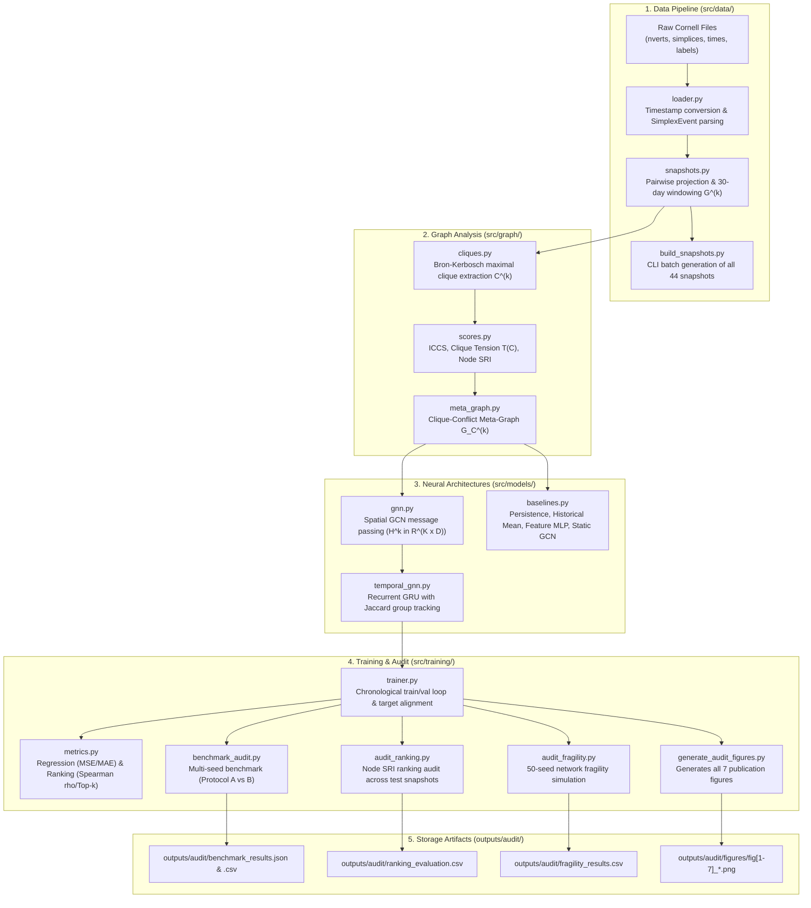

# Source Code Architecture & Scientific Methodology Reference (`src/`)

This document provides a comprehensive, file-by-file technical reference for the Temporal Graph Neural Network (GNN) implementation, data structures, loss functions, evaluation protocols, and empirical audit scripts.

---

## 1. Complete System Architecture & Pipeline

---

## 2. File-by-File Breakdown & Technical Description

### Directory: `src/data/` (Data Loading & Snapshot Construction)

#### 1. `src/data/loader.py`
- **Purpose:** Loads, validates, and aligns raw Cornell simplicial vectors.
- **Key Functions:**
  - `load_raw_vectors(data_dir)`: Loads `email-Enron-nverts.txt`, `email-Enron-simplices.txt`, and `email-Enron-times.txt`.
  - `load_node_labels(data_dir)`: Loads `node-labels.txt` mapping integer node IDs to authenticated email addresses.
  - `convert_cornell_time_to_datetime(t_ms)`: Converts raw millisecond timestamps measured from Gregorian Year 1 AD (`0001-01-01 00:00:00 UTC`) to standard Python datetimes.
  - `parse_simplex_events(nverts, simplices, times)`: Reconstructs the 10,883 higher-order email events, resolving 115 timestamp inversions by chronological sorting.

#### 2. `src/data/snapshots.py`
- **Purpose:** Temporal windowing and higher-order simplex projection.
- **Key Functions:**
  - `project_simplex_to_edges(nodes)`: Expands a $k$-person email into all $k(k-1)/2$ pairwise undirected edges.
  - `build_graph_snapshots(events, window_days=30.0, stride_days=30.0)`: Generates 44 non-overlapping graph snapshots spanning Nov 1998 to June 2002.
  - `GraphSnapshot`: Dataclass storing snapshot ID, timestamps, NetworkX graph, event count, and properties (`num_nodes`, `num_edges`, `density`, `num_connected_components`).

#### 3. `src/data/build_snapshots.py`
- **Purpose:** Standalone CLI tool to build and save snapshot statistics and data validation reports.
- **Execution:** `python3 src/data/build_snapshots.py --data_dir Dataset/email-Enron`

---

### Directory: `src/graph/` (Cohesive Groups & Structural Conflict Scores)

#### 4. `src/graph/cliques.py`
- **Purpose:** Maximal clique extraction and filtering.
- **Key Functions:**
  - `extract_maximal_cliques(graph, min_size=3, top_k=30)`: Uses `nx.find_cliques` (Bron–Kerbosch algorithm) to discover all maximal cliques of size $\ge 3$, sorted by size and bounded to top $K'=30$.
  - `clique_jaccard_similarity(c1, c2)`: Computes intersection-over-union similarity between employee member sets.

#### 5. `src/graph/scores.py`
- **Purpose:** Structural conflict and tension calculations.
- **Key Functions:**
  - `compute_external_neighbors(graph, clique)`: $N_{ext}(C) = \{v \in V \setminus C \mid \exists u \in C, (u, v) \in E\}$.
  - `compute_boundary_overlap(graph, c1, c2)`: $(N_{ext}(C_1) \cap C_2) \cup (N_{ext}(C_2) \cap C_1)$.
  - `compute_iccs(graph, c1, c2)`: $\text{ICCS}(C_1, C_2) = \frac{|\text{overlap}(C_1, C_2)|}{|C_1| + |C_2|}$.
  - `compute_clique_tension(graph, clique, all_cliques)`: $T(C) = \sum_{C' \neq C} \text{ICCS}(C, C')$.
  - `compute_silo_risk_index(cliques, tensions, all_nodes)`: $\text{SRI}(v) = \sum_{C \ni v} T(C)$.
  - `compute_clique_features(graph, clique, all_cliques)`: Computes a 5-dimensional feature vector for each clique:
    1. Clique size $|C|$
    2. Internal edge density
    3. External boundary expansion ratio $|N_{ext}(C)| / |C|$
    4. Conflict degree (number of adjacent cliques with $\text{ICCS} > 0$)
    5. Instantaneous clique tension $T(C)$

#### 6. `src/graph/meta_graph.py`
- **Purpose:** Constructs the higher-order Clique-Conflict Meta-Graph $G_C^{(k)}$.
- **Key Structures:**
  - `CliqueMetaGraph`: Stores meta-nodes (cliques), node feature tensor $X \in \mathbb{R}^{K \times 5}$, edge index tensor, ICCS edge weight tensor, ground-truth tension vector, and employee-to-clique map.
  - `build_clique_meta_graph(snapshot, cliques)`: Creates the meta-graph where edges connect cliques with $\text{ICCS} > 0$.

---

### Directory: `src/models/` (Neural Network Architectures & Baselines)

#### 7. `src/models/gnn.py`
- **Purpose:** Spatial Graph Convolutional Network (GCN) layer and encoder.
- **Key Functions:**
  - `build_dense_normalized_adjacency(num_nodes, edge_index, edge_weights)`: Computes $\hat{A} = \tilde{D}^{-1/2} \tilde{A} \tilde{D}^{-1/2}$ with self-loops.
  - `SpatialGCN`: 2-layer GCN with layer normalization, ReLU, and dropout.

#### 8. `src/models/baselines.py`
- **Purpose:** Benchmark baselines for empirical comparison.
  - `PersistenceBaseline`: Predicts that future tension equals currently observed tension ($\hat{T}^{(k+1)} = T^{(k)}$).
  - `HistoricalMeanBaseline`: Predicts the mean tension observed across training snapshots.
  - `FeatureOnlyMLP`: 3-layer MLP predicting tension directly from the 5 clique features, ignoring graph structure.
  - `StaticGCNModel`: Spatial GCN with prediction head, completely lacking temporal memory.

#### 9. `src/models/temporal_gnn.py`
- **Purpose:** Proposed Temporal GNN combining Spatial GCN and Recurrent GRU with Jaccard-based clique tracking.
- **Key Functions:**
  - `match_cliques_jaccard(prev_cliques, curr_cliques, threshold=0.5)`: Bipartite matching connecting persisting groups across snapshots.
  - `TemporalGNN.forward_snapshot(meta, prev_meta, prev_h)`:
    1. Spatial GCN encodes clique meta-graph into spatial embeddings $h_i^{(k)} \in \mathbb{R}^D$.
    2. GRUCell updates persisting cliques ($J \ge 0.5$): $s_i^{(k)} = \text{GRUCell}(h_i^{(k)}, s_j^{(k-1)})$.
    3. Newly appearing cliques ($J < 0.5$) initialize with spatial embedding $s_i^{(k)} = h_i^{(k)}$.
    4. Prediction head computes $\hat{T}^{(k+1)}(C_i) = \text{Softplus}(\text{MLP}(s_i^{(k)}))$.
  - `TemporalGNN.predict_node_sri(predicted_tensions, meta, all_node_ids)`: Projects predicted tensions back to employee nodes.

---

### Directory: `src/training/` (Training, Evaluation & Scientific Audit)

#### 10. `src/training/trainer.py`
- **Purpose:** Chronological training loop, validation checkpointing, and evaluation.
- **Key Functions:**
  - `build_forecasting_targets(meta_graphs, delta=1, jaccard_threshold=0.5)`: Generates future targets aligned with snapshot $k+\Delta$.
  - `train_temporal_gnn()`: Sequentially iterates through snapshots using truncated BPTT (`curr_h.detach()`), tracking validation MSE to save the optimal checkpoint.
  - `evaluate_model()`: Computes MSE, RMSE, MAE, Pearson $r$, Spearman $\rho$, and top-$k$ overlap.

#### 11. `src/training/metrics.py`
- **Purpose:** Regression and ranking metrics.
  - `compute_regression_metrics(y_true, y_pred)`: MSE, RMSE, MAE, Pearson $r$.
  - `compute_ranking_metrics(true_sri, pred_sri, top_k=10)`: Spearman $\rho$ and top-$k$ overlap.

#### 12. `src/training/benchmark_audit.py`
- **Purpose:** Multi-seed scientific benchmark running 5 independent seeds across all 6 models, reporting both Protocol A and Protocol B.
- **Execution:** `python3 src/training/benchmark_audit.py`

#### 13. `src/training/audit_ranking.py`
- **Purpose:** Snapshot-by-snapshot node SRI ranking evaluation comparing GNN against Degree, Betweenness, and Persistence across all nodes and active nodes only.
- **Execution:** `python3 src/training/audit_ranking.py`

#### 14. `src/training/audit_fragility.py`
- **Purpose:** 50-seed network fragility simulation testing in-sample and out-of-sample forward disruption.
- **Execution:** `python3 src/training/audit_fragility.py`

#### 15. `src/training/generate_audit_figures.py`
- **Purpose:** Generates all 7 publication-ready figures with multi-seed error bars, 50-seed CI bands, and audited captions.
- **Execution:** `python3 src/training/generate_audit_figures.py`

---

## 3. Training & Evaluation Protocols

1. **Chronological Splitting (Zero Temporal Leakage):**
   - **Train (70%):** Snapshots 0 to 29 (Nov 1998 to April 2001)
   - **Validation (15%):** Snapshots 30 to 35 (May 2001 to Oct 2001)
   - **Held-Out Test (15%):** Snapshots 36 to 42 (Nov 2001 to May 2002)

2. **Truncated Backpropagation Through Time (TBPTT):**
   - The recurrent state $s^{(k)}$ is detached before passing to step $k+1$, ensuring stable gradients over the 44-snapshot sequence.

3. **Evaluation Protocols:**
   - **Protocol A (Unconditional):** All 109 test cliques evaluated; dissolved cliques get target $y = 0.0$.
   - **Protocol B (Conditional on Survival):** Only the 39 persisting cliques ($J \ge 0.5$) evaluated.
